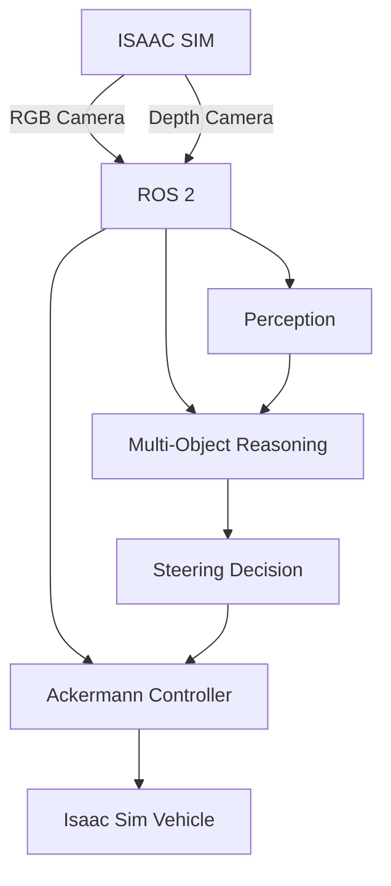

# System Architecture

## High-Level Architecture

## Component Architecture

### Isaac Sim
- Physics-based simulation environment
- Provides RGB-D camera streams
- Vehicle physics and steering control
- ROS 2 bridge for message passing

### RGB-D Camera (in Isaac Sim)
- Provides RGB image stream (`sensor_msgs/msg/Image`)
- Provides Depth image stream (`sensor_msgs/msg/Image`)
- Provides CameraInfo (`sensor_msgs/msg/CameraInfo`)
- TF frame relationships (`camera_link`, `rgb_optical_frame`, `depth_optical_frame`)

### ROS 2 Bridge
- Translates Isaac Sim sensor data to ROS 2 messages
- Provides TF tree publication
- Exposes vehicle state as ROS 2 messages
- Configurable topic names and frame IDs

### ROS 2 Topics

| Topic | Message Type | Purpose |
|-------|-------------|---------|
| `/camera/rgb/image_raw` | `sensor_msgs/msg/Image` | RGB image stream |
| `/camera/depth/image_raw` | `sensor_msgs/msg/Image` | Depth image stream |
| `/camera/rgb/camera_info` | `sensor_msgs/msg/CameraInfo` | RGB camera calibration |
| `/camera/depth/camera_info` | `sensor_msgs/msg/CameraInfo` | Depth camera calibration |
| `/tf` | `TF` | Coordinate transforms |
| `/clock` | `rosgraph_msgs/msg/Clock` | Simulation clock |
| `/cmd_ackermann` | Ackermann-compatible | Vehicle control commands |

### Perception
- Receives RGB, depth, and CameraInfo from ROS 2
- Outputs detected objects with position, distance, class, confidence
- Modular: interchangeable AI models for RGB and depth processing

### Multi-Object Reasoning
- Processes detected objects from perception
- Evaluates relationships between objects (people, static obstacles)
- Determines steering priorities based on object positions and trajectories

### Steering Decision
- Receives object information from reasoning module
- Rule-based initial implementation:
  - If path clear: continue forward
  - If person/obstacle close and centered: reduce speed / stop
  - If obstacle on left: steer right
  - If obstacle on right: steer left
  - If multiple obstacles: evaluate free-space alternatives
- Outputs desired steering angle and speed

### Ackermann Controller
- Receives steering angle and speed commands
- Converts to wheel-level steering angles using Ackermann geometry
- Sends commands to Isaac Sim vehicle physics
- Parameters: max steering angle, steering rate, wheelbase, track

### Isaac Sim Vehicle
- Four-wheeled Ackermann-steering vehicle
- Chassis with four wheels (front left, front right, rear left, rear right)
- Steering mechanism on front wheels
- Physics body with collision geometry
- RGB-D camera mounted at configurable position

## Data Flow

1. Isaac Sim renders scene with RGB-D camera
2. Camera captures RGB and depth images
3. ROS 2 bridge publishes images to ROS 2 topics
4. Perception node subscribes to topics, processes images
5. Detected objects published as ROS 2 messages
6. Multi-object reasoning evaluates object relationships
7. Steering decision determines appropriate action
8. Ackermann controller converts to wheel commands
9. Isaac Sim physics applies vehicle motion
10. Loop continues at configurable rate