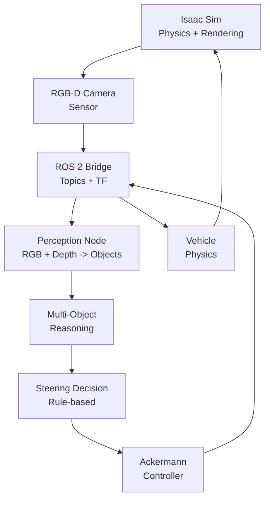

# Simulation Workflow

This document describes the end-to-end simulation workflow for the multi-object steering project.

## Overview

The simulation workflow connects Isaac Sim, ROS 2, perception, steering decision, and vehicle control in a closed loop.



## Pipeline Stages

### 1. Isaac Sim Stage
- **Physics simulation**: Runs at 50 Hz (configurable via `simulation.physics.dt`)
- **Rendering**: Produces RGB and depth images from camera sensor
- **ROS 2 Bridge**: Publishes sensor data and TF to ROS 2 topics

### 2. ROS 2 Communication Stage
Published topics from Isaac Sim:
- `/camera/rgb/image_raw` (sensor_msgs/Image) - RGB camera stream
- `/camera/depth/image_raw` (sensor_msgs/Image) - Depth camera stream
- `/camera/rgb/camera_info` (sensor_msgs/CameraInfo) - RGB calibration
- `/camera/depth/camera_info` (sensor_msgs/CameraInfo) - Depth calibration
- `/tf` (TFMessage) - Coordinate transforms
- `/clock` (rosgraph_msgs/Clock) - Simulation time

Subscribed topics to Isaac Sim:
- `/cmd_ackermann` (ackermann_msgs/AckermannDriveStamped) - Steering commands

### 3. Perception Stage
Input: RGB image, Depth image, CameraInfo
Processing:
- RGB: Object detection/classification (teammate's model)
- Depth: Distance estimation, point cloud generation
- Fusion: RGB bounding boxes + depth = 3D object positions
Output: `detected_objects` topic with object list (class, position, distance, confidence)

### 4. Multi-Object Reasoning Stage
Input: Detected objects from perception
Processing:
- Cluster objects by type (person, obstacle)
- Track object positions over time
- Predict trajectories for moving objects
- Identify free space corridors
Output: `object_situation` with reasoned object information

### 5. Steering Decision Stage
Input: Object situation from reasoning
Processing (rule-based initial implementation):
```
IF no obstacles in path:
    continue straight at target speed
ELSE IF person/obstacle centered and close:
    reduce speed, possibly stop
ELSE IF obstacle on left:
    steer right
ELSE IF obstacle on right:
    steer left
ELSE IF multiple obstacles:
    evaluate free space, choose safest direction
```
Output: `steering_command` (desired steering angle, desired speed)

### 6. Ackermann Controller Stage
Input: Steering command (angle, speed)
Processing:
- Convert steering angle to left/right front wheel angles using Ackermann geometry
- Apply PID control for speed and steering
- Apply rate limits and safety constraints
Output: Wheel commands to Isaac Sim via ROS 2

### 7. Vehicle Physics Stage
Input: Wheel steering angles, drive torque
Processing:
- Physics simulation applies forces
- Vehicle moves through environment
- Sensors capture new observations
Output: New vehicle state, new camera images (back to stage 1)

## Data Flow Summary

| Stage | Input | Output | Rate |
|-------|-------|--------|------|
| Isaac Sim | Wheel commands | RGB, Depth, TF, Clock | 30 Hz |
| ROS 2 Bridge | Sim data | ROS topics | 30 Hz |
| Perception | RGB, Depth, CameraInfo | Detected objects | 10-30 Hz |
| Reasoning | Detected objects | Object situation | 10-30 Hz |
| Steering | Object situation | Steering command | 10-30 Hz |
| Controller | Steering command | Wheel commands | 50 Hz |
| Physics | Wheel commands | Vehicle state | 50 Hz |

## Running the Simulation

### Prerequisites
1. Isaac Sim 5.1.0+ installed at `/home/ubuntu/isaacsim/`
2. ROS 2 Humble sourced: `source /opt/ros/humble/setup.bash`
3. Isaac Sim Python environment: `source /home/ubuntu/isaacsim/python.sh`

### Launch Steps
```bash
# Terminal 1: Start Isaac Sim with ROS 2 bridge
cd /home/ubuntu/SKATEBOARD_IRP
source /opt/ros/humble/setup.bash
source /home/ubuntu/isaacsim/python.sh
python3 isaac_sim/scripts/run_simulation.py

# Terminal 2: Start perception node
source /opt/ros/humble/setup.bash
ros2 run rgbd_perception perception_node

# Terminal 3: Start steering decision node
source /opt/ros/humble/setup.bash
ros2 run steering_controller steering_node

# Terminal 4: Start RViz for visualization
source /opt/ros/humble/setup.bash
rviz2 -d configs/rviz_config.rviz
```

### Configuration
All parameters are in `configs/`:
- `vehicle.yaml` - Vehicle dimensions and physics
- `camera.yaml` - Camera intrinsics/extrinsics and topics
- `simulation.yaml` - Physics, rendering, ROS 2 bridge settings
- `steering.yaml` - Controller gains and safety parameters

Scenarios in `scenarios/` define initial conditions.

## Verification Checklist

At each stage, verify:
- [ ] Isaac Sim launches without errors
- [ ] Camera topics visible in `ros2 topic list`
- [ ] Images viewable in RViz (`/camera/rgb/image_raw`, `/camera/depth/image_raw`)
- [ ] TF tree complete: `world` -> `base_link` -> `camera_link` -> optical frames
- [ ] `/clock` publishing simulation time
- [ ] Vehicle responds to `/cmd_ackermann` commands
- [ ] Perception node outputs detected objects
- [ ] Steering node outputs commands based on objects
- [ ] Vehicle avoids obstacles in test scenarios

## Common Issues

| Issue | Cause | Fix |
|-------|-------|-----|
| No camera topics | ROS 2 bridge not enabled | Enable `isaacsim.ros2.bridge` extension |
| TF missing | Bridge not publishing TF | Check `simulation.ros2_bridge.publish_tf: true` |
| Vehicle doesn't move | Wrong command topic | Verify `/cmd_ackermann` topic name matches |
| Perception gets no images | Topic name mismatch | Check `camera.yaml` topic names |
| Sim runs slow | Physics too complex | Reduce physics substeps, simplify collision meshes |