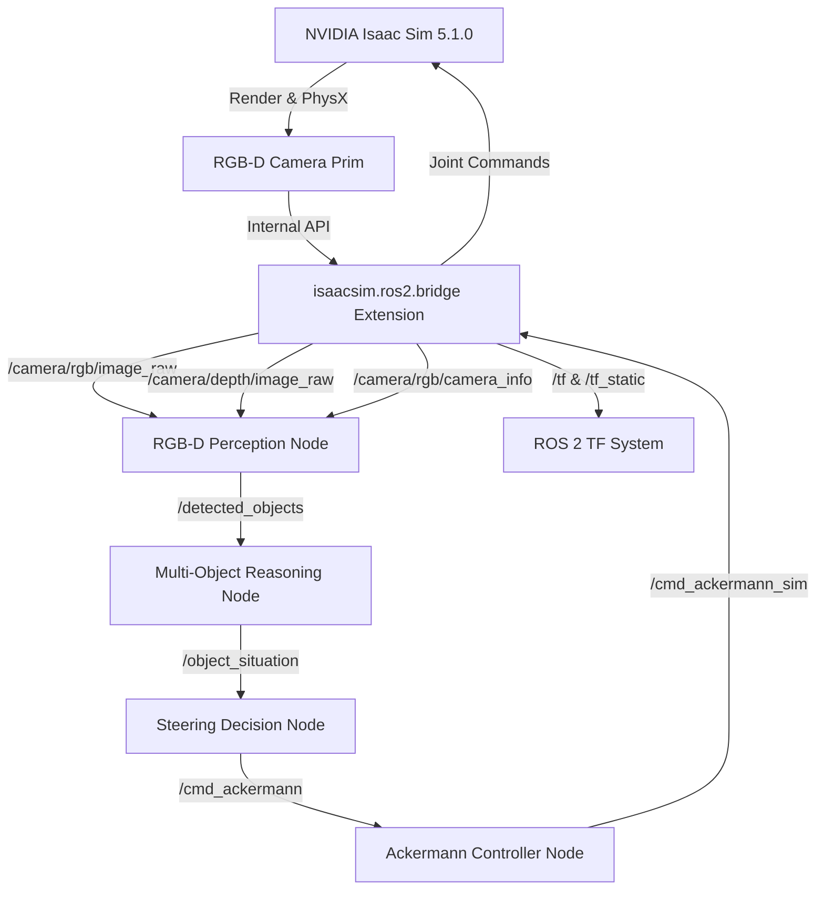

# Simulation World Design Plan & Educational Guide

This document serves two critical functions for the Multi-Object Steering Simulation Project:
1. **Educational Foundation**: Teaches core NVIDIA Isaac Sim, Universal Scene Description (USD), ROS 2 integration, and simulation design concepts from scratch for a developer new to Isaac Sim.
2. **Complete World Design Plan**: Details the full architectural plan, USD stage hierarchy, vehicle model design, physics tuning, laboratory environment structure, RGB-D camera specification, ROS 2 data flow, TF tree, scenario system, steering control pipeline, and evaluation metrics before implementation begins.

---

## 1. Educational Primer: Learning Isaac Sim & USD from Scratch

Before building the simulation world, this section explains the foundational concepts of NVIDIA Isaac Sim, Pixar's Universal Scene Description (USD), and ROS 2 bridge integration.

### 1.1 Fundamental Concepts

#### What is Isaac Sim?
NVIDIA Isaac Sim is a robotics simulation application built on **NVIDIA Omniverse**. It leverages RTX ray-tracing/path-tracing and PhysX 5 physics engine to deliver photorealistic and physically accurate virtual environments for training, testing, and evaluating autonomous robots. Unlike legacy simulators, Isaac Sim models optical phenomena (depth sensors, lens distortion, lighting) and multi-body dynamics at high throughput.

#### What is USD (Universal Scene Description)?
USD is an open 3D scene description format originally developed by Pixar. Rather than treating 3D graphics as static meshes, USD is an extensible, hierarchical scene graph that describes geometry, materials, lighting, physics, transforms, and custom metadata in a unified file structure (`.usd`, `.usda`, `.usdc`).

#### What is a Stage?
In USD, the **Stage** (`UsdStage`) is the root container representing the complete 3D world. Everything in the simulation—from the floor and lighting to the vehicle and cameras—lives on the Stage.

#### What is a Prim (Primitive)?
A **Prim** (`UsdPrim`) is the fundamental node in the USD stage tree. Every entity in the scene is a Prim. Prims can represent geometric shapes (cubes, meshes), lights, cameras, physics materials, or organizational containers. Each Prim has a unique path (e.g., `/World/Vehicle`).

#### What is an Xform?
An **Xform** (`UsdGeomXform`) is a transform prim used to define spatial properties (Position, Rotation, Scale) in 3D space. It acts as a frame of reference for all child prims attached below it.

#### What is an Articulation?
An **Articulation** (`PhysxSchemaPhysxArticulationAPI` / `UsdPhysicsArticulationRootAPI`) is a physics construct representing a connected system of rigid bodies linked by joints (e.g., a vehicle with chassis, steering linkages, and wheels). Articulations use reduced-coordinate solver formulations, preventing numerical drift and separation between joined parts.

#### Visual Geometry vs. Collision Geometry vs. Physics
- **Visual Geometry**: Meshes and textures rendered by the camera for display and perception algorithms. They can be high-detail without affecting performance.
- **Collision Geometry**: Simplified geometric approximations (boxes, cylinders, convex hulls) used by the physics engine to calculate contact and collisions. Simple collision meshes keep physics running fast and stable.
- **Physics Properties**: Non-geometric dynamic properties attached to rigid bodies (mass, center of mass, inertia tensor, friction coefficients).

#### What are Rigid Bodies and Joints?
- **Rigid Body**: A prim with mass and inertia that obeys Newton's laws of motion.
- **Joints**: Physics constraints restricting relative motion between two rigid bodies (e.g., `RevoluteJoint` for spinning wheels or turning steering linkages).

#### What is a Sensor Prim & How Does an RGB-D Camera Work in Isaac Sim?
- **Sensor Prim**: An extension prim (such as `UsdGeomCamera`) placed on the stage to simulate real-world physical sensors.
- **Camera in Isaac Sim**: Uses RTX rendering pipelines to compute exact per-pixel ray paths from the scene to the sensor array.
- **Depth Generation**: Isaac Sim computes depth by measuring the linear distance (Z-depth) or ray distance from the camera's optical focal point to the nearest rendered surface, producing synthetic depth maps without sensor noise (or with simulated noise).

#### ROS 2 Bridge, Topics, and TF
- **ROS 2 Bridge (`isaacsim.ros2.bridge`)**: An internal Omniverse C++/Python extension that connects Isaac Sim internal buffers directly to ROS 2 message publishers and subscribers via standard DDS middleware without network overhead.
- **ROS 2 Topic**: A named data bus over which nodes exchange messages (e.g., `/camera/rgb/image_raw`).
- **TF (Transform Tree)**: The ROS 2 transform system tracking spatial relationships between coordinate frames over time (e.g., `world` → `odom` → `base_link` → `camera_link`).

#### Ground Truth vs. Perception Input
- **Ground Truth**: Exact, perfect state data provided directly by the simulation engine (exact 3D positions, bounding boxes, trajectories, collision flags). Ground truth is used **strictly for evaluation**.
- **Perception Input**: The noisy RGB and depth images processed by the perception algorithms. The perception pipeline must infer object locations without inspecting Ground Truth data.

#### Kinematic vs. Physics-Based Control
- **Kinematic Control**: Teleports or directly sets position/velocity of the vehicle according to mathematical equations, ignoring friction, wheel slip, mass, and inertia. Useful for early pipeline testing.
- **Physics-Based Control**: Applies torques and steering angles to wheel joints; motion emerges naturally from friction, mass, and wheel contact dynamics. Used for realistic validation.

#### Why Use Python Scripts Instead of Manual GUI Building?
Manual GUI actions cannot be version-controlled, automated, or reproduced reliably. Python scripts (`Omniverse Kit SDK` / `isaacsim.core.api`) enable automated scenario generation, repeatable experiment runs, parameter sweeping, and continuous integration testing.

---

## 2. World Structure (USD Hierarchy)

The USD stage hierarchy follows a clean, modular, and standard Isaac Sim architecture:

```
/World
  ├── /Environment (Xform)
  │     ├── /Floor (UsdGeomCube / Mesh, Visual + Collision)
  │     ├── /Walls (Xform, Visual + Collision)
  │     ├── /Partitions (Xform, Visual + Collision)
  │     └── /Furniture (Xform, Visual + Collision)
  ├── /Vehicle (Xform, Articulation Root)
  │     ├── /Chassis (Rigid Body, Visual + Collision)
  │     ├── /Seat (Visual only, child of Chassis)
  │     ├── /SteeringAssembly (Xform, Revolute Joints)
  │     ├── /Wheel_FL, /Wheel_FR (Rigid Bodies, Revolute Joints)
  │     └── /Wheel_RL, /Wheel_RR (Rigid Bodies, Revolute Joints)
  ├── /Sensors (Xform)
  │     └── /RGBD_Camera (UsdGeomCamera, attached to Chassis)
  ├── /Lighting (Xform)
  │     ├── /DomeLight (Environment ambient light)
  │     └── /DistantLight (Sunlight/overhead ceiling lights)
  ├── /Scenario (Xform)
  │     ├── /People (Xform, Animated/Static Humanoid Prims)
  │     └── /Obstacles (Xform, Dynamic/Static Props)
  └── /GroundTruth (Xform, Non-collidable, Metadata tracking)
```

### Prim Roles & Definitions

| Prim Path | Represented Object | Visual Geometry | Collision Mesh | Physics Participant | Ground Truth Only |
| :--- | :--- | :---: | :---: | :---: | :---: |
| `/World/Environment` | Floor, walls, lab fixtures | Yes | Yes (Convex Hull / Box) | Static Collidable | No |
| `/World/Vehicle` | Physical mobility platform | Yes | Yes (Simplified Boxes/Cylinders) | Dynamic Articulation | No |
| `/World/Sensors/RGBD_Camera` | RGB-D sensor head | Yes (Small body) | No | No | No |
| `/World/Lighting` | Ambient & overhead lighting | No (Rendered effect) | No | No | No |
| `/World/Scenario/People` | Pedestrians in lab | Yes (Humanoid mesh) | Yes (Cylinder approximation) | Kinematic/Dynamic | No |
| `/World/Scenario/Obstacles` | Tables, chairs, columns | Yes | Yes (Box/Convex) | Static/Dynamic | No |
| `/World/GroundTruth` | Object 3D bounding boxes & state | No | No | No | Yes |

---

## 3. Simplified Vehicle Design

### Visual & Physical Reference
Based on reference photographs (`references/vehicle/`), the physical platform is a compact four-wheeled indoor mobility vehicle (custom electric chassis/mobility scooter platform).

```
                      Front (RGB-D Camera Mounted Here)
                      ┌────────────────────────┐
                      │    [RGB-D Camera]      │
        Wheel_FL [||] │  ┌──────────────────┐  │ [||] Wheel_FR
        (Steered)     │  │ Steering Assembly│  │ (Steered)
                      │  └──────────────────┘  │
                      │                        │
                      │    ┌──────────────┐    │
                      │    │ Seat & Back  │    │
                      │    └──────────────┘    │
                      │                        │
        Wheel_RL [||] │  [Battery/Chassis]     │ [||] Wheel_RR
        (Driven)      └────────────────────────┘ (Driven)
                                Rear
```

### Planned Simplified Model Specifications

- **Wheel Configuration**: 4 wheels (Front: Steered, Rear: Drive/Fixed orientation).
- **Chassis/Platform**: Rectangular lower frame (approx. $1.8\text{ m}$ length $\times 1.2\text{ m}$ width $\times 0.3\text{ m}$ height base).
- **Seat & Backrest**: Simplified box/curved primitive attached to chassis center-rear.
- **Front Steering Assembly**: Dual steering knuckles linked via Ackermann geometry.
- **Camera Mount Location**: Front center edge of vehicle platform at height $1.2\text{ m}$ above ground level, tilted down by $-8.5^\circ$ ($0.15\text{ rad}$).

### Simplified vs. Retained Details

| Vehicle Feature | Treatment | Rationale |
| :--- | :--- | :--- |
| Overall Footprint & Wheelbase | **Retained Exactly** | Critical for turning radius, clearance, and collision avoidance |
| Wheel Radius & Width | **Retained** | Required for accurate linear speed and contact kinematics |
| Front Ackermann Steering | **Retained** | Essential for representative steering dynamics vs differential drive |
| Steering Column & Frame Tube Detail | **Simplified** | Detailed tube geometry adds CAD overhead without improving physics |
| Cushion Curves & Fabric Texture | **Simplified** | Purely cosmetic; simplified primitives maintain performance |

### Model Construction Recommendation: Hybrid Primitive + Import Approach
**Recommendation**: Build the core physics articulation (chassis, wheels, joints) using clean Isaac Sim geometric primitives (Boxes and Cylinders) first. Apply visual material bindings to match the photographed dark frame, white rims, and tan seat. If high-fidelity visuals are required later, swap the visual geometry subgroup with an imported low-poly mesh while keeping the primitive physics collision structure intact.

---

## 4. Vehicle Physics Model & Ackermann Geometry

### Physics Formulation
- **Rigid Body Mass**: Vehicle total mass $\approx 150.0\text{ kg}$ (Chassis: $120\text{ kg}$, Wheels: $7.5\text{ kg}$ each).
- **Inertia Tensor**: Diagonally approximated box inertia based on length ($1.8\text{ m}$), width ($1.2\text{ m}$), height ($1.0\text{ m}$).
- **Wheel Contact & Friction**: Anisotropic friction model with longitudinal friction factor $\mu_l = 0.9$ and lateral friction factor $\mu_t = 0.8$.
- **Suspension**: Simplified spring-damper joint drive on vertical joint axes (or rigid mounting with rubber tire compliance for indoor smooth floor).

### Dimensional Summary

```
           |<- - - Front Track (1.0 m) - - ->|
           
   +-----+ ┌─────────────────────────────────┐ +-----+
   | FL  |=│======= Front Axle Line =========│=| FR  |
   +-----+ └─────────────────────────────────┘ +-----+
      |                     │                     |
      |                     │                     |
      |                     │ Wheelbase           |
      |                     │ (1.1 m)             |
      |                     │                     |
      |                     ▼                     |
   +-----+ ┌─────────────────────────────────┐ +-----+
   | RL  |=│======= Rear Axle Line  =========│=| RR  |
   +-----+ └─────────────────────────────────┘ +-----+
           
           |<- - - Rear Track  (1.0 m) - - ->|
```

- **Wheelbase ($L$)**: $1.1\text{ m}$ (measured center-to-center between front and rear axles).
- **Track Width ($W$)**: $1.0\text{ m}$ (front and rear track width).
- **Wheel Radius ($R$)**: $0.25\text{ m}$.

### Ackermann Steering Geometry
For a desired steering angle $\delta$ of the virtual center front wheel, the inner and outer steering wheel angles ($\delta_{in}, \delta_{out}$) are derived using:

$$\delta_{in} = \arctan\left(\frac{L \cdot \tan\delta}{L - \frac{W}{2}\tan\delta}\right)$$

$$\delta_{out} = \arctan\left(\frac{L \cdot \tan\delta}{L + \frac{W}{2}\tan\delta}\right)$$

### Phased Physics Control Strategy
1. **Stage 1 (Kinematic Drive)**: Test camera streaming, ROS 2 topics, and basic TF tree using direct kinematic velocity commands (`Twist` / simple position displacement).
2. **Stage 2 (Physics Ackermann Control)**: Enable PhysX articulation drives on wheel revolute joints driven by ROS 2 `AckermannDriveStamped` commands.

---

## 5. Representative Laboratory Environment Design

### Visual Reference Analysis (`references/lab/`)
The laboratory is an indoor academic research space characterized by:
- **Floor**: Standard grey/beige vinyl tiles.
- **Walls & Columns**: Perimeter concrete walls, glass office partitions, wooden slatted columns.
- **Accents**: Yellow/green painted wall sections and pillars.
- **Furniture**: Standard office desks, rolling chairs, computer monitors, lab tables.
- **Ceiling & Lighting**: Drop-ceiling grid with fluorescent/LED panel lighting, ceiling fans.

### Modular Construction Strategy

```
           +----------------------------------------------------+
           | [Wall - Concrete]              [Window / Blind]    |
           |                                                    |
           |   +----------+                  +--------------+   |
           |   | Lab Desk |                  | Glass Office |   |
           |   +----------+                  | Partition    |   |
           |      [Chair]                    +--------------+   |
           |                                                    |
           |                  ================                  |
           |                  Navigable Path                   |
           |                  ================                  |
           |                                                    |
           |   +--------------+                 +-----------+   |
           |   | Wood Column  |                 | Yellow    |   |
           |   | (Slatted)    |                 | Accent    |   |
           |   +--------------+                 +-----------+   |
           +----------------------------------------------------+
```

### Impact Breakdown of Environment Elements

| Element | Depth Perception | Obstacle Detection | Steering Choice | Visual Realism | Performance Impact |
| :--- | :---: | :---: | :---: | :---: | :---: |
| Tiled Floor | Low | Low | Low | High | Very Low |
| Solid Walls | High | High | High | Medium | Very Low |
| Glass Partitions | **Critical** (Refraction/Depth fail) | High | High | High | Medium |
| Slatted Columns | High | High | High | High | Low |
| Desks / Chairs | High | High | High | High | Low (Instanced) |

---

## 6. Reusable Pedestrians & Static Obstacles

### Pedestrian Asset Architecture
- **Visual Representation**: Modular humanoid USD assets (`UsdGeomMesh` with casual indoor clothing).
- **Physics Approximation**: Vertical capsule collision volume ($0.4\text{ m}$ radius, $1.75\text{ m}$ height).
- **Movement Control**: Configurable scriptable path controller (moving along defined linear or curved trajectories at controlled speeds $0.5\text{ m/s} - 1.2\text{ m/s}$).

### Static Obstacle Assets
- **Lab Table**: $1.5\text{ m} \times 0.8\text{ m} \times 0.75\text{ m}$ box collision.
- **Office Chair**: Cylinder seat ($0.5\text{ m}$ radius) + low box backrest collision.
- **Slatted Column**: Fixed box pillar ($0.6\text{ m} \times 0.6\text{ m} \times 3.0\text{ m}$).
- **Glass Partition**: Thin tall box ($0.1\text{ m} \times 2.0\text{ m} \times 2.5\text{ m}$).

---

## 7. Simulated RGB-D Camera Specifications

### Configurable Camera Parameters

| Parameter | Configuration Value | Notes / Description |
| :--- | :--- | :--- |
| **Mounting Position** | $(X: 0.9\text{ m}, Y: 0.0\text{ m}, Z: 1.2\text{ m})$ | Relative to `base_link` (rear axle ground center) |
| **Mounting Orientation** | $(\text{Roll}: 0^\circ, \text{Pitch}: -8.5^\circ, \text{Yaw}: 0^\circ)$ | $-0.15\text{ rad}$ pitch down |
| **RGB Resolution** | $640 \times 480\text{ pixels}$ | Standard perception resolution |
| **Depth Resolution** | $640 \times 480\text{ pixels}$ | Registered depth stream |
| **Horizontal FOV** | $70.0^\circ$ ($1.22\text{ rad}$) | Typical Intel RealSense D435 FOV |
| **Vertical FOV** | $45.0^\circ$ ($0.79\text{ rad}$) | Corresponding vertical aspect ratio |
| **Frame Rate** | $30\text{ Hz}$ | Synchronized sensor publish rate |
| **Depth Clipping Range** | $0.1\text{ m} - 10.0\text{ m}$ | Valid depth sensing range |
| **RGB Topic** | `/camera/rgb/image_raw` | `sensor_msgs/msg/Image` |
| **Depth Topic** | `/camera/depth/image_raw` | `sensor_msgs/msg/Image` (32FC1 format) |
| **Camera Info Topics** | `/camera/rgb/camera_info`, `/camera/depth/camera_info` | `sensor_msgs/msg/CameraInfo` |
| **TF Frame Names** | `camera_link`, `camera_rgb_optical_frame`, `camera_depth_optical_frame` | Standard ROS REP-105 / REP-103 frames |

---

## 8. ROS 2 Data Flow Architecture

The data pipeline connects Isaac Sim to perception and steering through standardized ROS 2 topics:



### ROS 2 Interface Specifications

| Topic Name | Message Type | Direction | Rate | Description |
| :--- | :--- | :--- | :---: | :--- |
| `/camera/rgb/image_raw` | `sensor_msgs/msg/Image` | Sim $\rightarrow$ Perception | 30 Hz | Raw 24-bit RGB frame |
| `/camera/depth/image_raw` | `sensor_msgs/msg/Image` | Sim $\rightarrow$ Perception | 30 Hz | 32-bit floating point depth map (m) |
| `/camera/rgb/camera_info` | `sensor_msgs/msg/CameraInfo` | Sim $\rightarrow$ Perception | 30 Hz | Intrinsic matrices & distortion |
| `/tf` | `tf2_msgs/msg/TFMessage` | Sim $\leftrightarrow$ ROS 2 | 50 Hz | Dynamic coordinate transforms |
| `/tf_static` | `tf2_msgs/msg/TFMessage` | Sim $\rightarrow$ ROS 2 | Latched | Static frame transforms |
| `/clock` | `rosgraph_msgs/msg/Clock` | Sim $\rightarrow$ ROS 2 | 50 Hz | Simulation clock synchronization |
| `/odom` | `nav_msgs/msg/Odometry` | Sim $\rightarrow$ Controller | 50 Hz | Simulated vehicle ground truth odom |
| `/cmd_ackermann` | `ackermann_msgs/msg/AckermannDriveStamped` | Decision $\rightarrow$ Controller | 30 Hz | Desired speed & steering angle |

---

## 9. TF Coordinate Hierarchy & Frame Conventions

```
world (Isaac Sim Global Origin)
  └── odom (World-fixed Odometry Frame)
        └── base_link (Vehicle Rear Axle Ground Center)
              └── camera_link (Physical Camera Housing Center)
                    ├── camera_rgb_optical_frame (Z-Forward, X-Right, Y-Down)
                    └── camera_depth_optical_frame (Z-Forward, X-Right, Y-Down)
```

### Frame Conventions & Alignment
- **ROS Body Frame (`base_link`)**: X-Forward, Y-Left, Z-Up.
- **Camera Physical Frame (`camera_link`)**: Aligned with `base_link` orientation.
- **Optical Frames (`camera_rgb_optical_frame`, `camera_depth_optical_frame`)**: Standard ROS Optical Convention (REP-103):
  - $+Z$: Points out of the lens toward the scene (depth direction)
  - $+X$: Points to the right of the image plane
  - $+Y$: Points down toward the bottom of the image plane

---

## 10. Ground Truth vs. Perception Input Separation

To guarantee academic rigor, simulation ground truth is strictly isolated from perception inputs:

```
                         ┌─────────────────────────────┐
                         │   Isaac Sim Ground Truth    │
                         │ (Exact 3D Bboxes, Poses)    │
                         └──────────────┬──────────────┘
                                        │
                                        ▼ (EVALUATION ONLY)
┌──────────────────┐           ┌─────────────────┐           ┌──────────────────┐
│ RGB-D Camera     │           │ ROS 2 Perception│           │ Quantitative     │
│ (Raw RGB + Depth)├──ROS 2──► │ Node (Inference)├──ROS 2──► │ Benchmark        │
└──────────────────┘           └─────────────────┘           │ (Error Metrics)  │
                                                             └──────────────────┘
```

1. **Perception Input Pipeline**: Perception nodes subscribe *only* to `/camera/rgb/image_raw`, `/camera/depth/image_raw`, and `/camera/rgb/camera_info`.
2. **Ground Truth Benchmark Pipeline**: A separate evaluation node subscribes to Ground Truth pose streams (`/ground_truth/objects`) and compares detected 3D bounding boxes against true positions to compute Precision, Recall, and Distance Error.

---

## 11. Configuration-Driven Scenario System

All simulation scenarios are defined in human-readable YAML configuration files loaded at launch time.

### Planned Scenarios (Scenarios 01–10)

1. `scenario_01_empty.yaml`: Open floor with no obstacles (baseline verification).
2. `scenario_02_single_person_center.yaml`: Static person centered $3.0\text{ m}$ ahead.
3. `scenario_03_person_left.yaml`: Person standing $2.5\text{ m}$ ahead, $0.8\text{ m}$ to the left.
4. `scenario_04_person_right.yaml`: Person standing $2.5\text{ m}$ ahead, $0.8\text{ m}$ to the right.
5. `scenario_05_person_crossing.yaml`: Pedestrian walking laterally across vehicle path at $0.8\text{ m/s}$.
6. `scenario_06_two_people.yaml`: Two pedestrians creating a narrow passing gap ($1.2\text{ m}$ apart).
7. `scenario_07_person_table.yaml`: Person sitting behind a lab desk ($3.0\text{ m}$ ahead).
8. `scenario_08_person_chair_column.yaml`: Complex obstacle cluster (person, rolling chair, slatted column).
9. `scenario_09_narrow_corridor.yaml`: Passageway bounded by glass partitions ($1.5\text{ m}$ wide gap).
10. `scenario_10_multiple_moving.yaml`: Dynamic scene with 2 walking pedestrians and static tables.

---

## 12. Steering Decision & Control Pipeline Strategy

### Rule-Based Reasoning Architecture
For early milestones, steering decisions follow an explicit, explainable rule set:

```
Input: Array of 3D detected objects [(class, x, y, z, size)]

1. Calculate Clearance Zones:
   - Emergency Stop Zone: Box(x: [0.0, 1.0m], y: [-0.6m, 0.6m])
   - Slow Down Zone: Box(x: [1.0, 3.0m], y: [-0.8m, 0.8m])
   - Left Sector Clearance: Box(x: [0.5, 3.0m], y: [0.2m, 1.2m])
   - Right Sector Clearance: Box(x: [0.5, 3.0m], y: [-1.2m, -0.2m])

2. Evaluate Rules:
   IF object in Emergency Stop Zone:
       Set target_speed = 0.0 m/s, target_steering = 0.0 rad
   ELSE IF object centered in Slow Down Zone:
       Set target_speed = 0.5 m/s
       IF Left Sector Clearance > Right Sector Clearance:
           Set target_steering = +0.35 rad (Steer Left)
       ELSE:
           Set target_steering = -0.35 rad (Steer Right)
   ELSE:
       Set target_speed = 1.2 m/s, target_steering = 0.0 rad (Proceed Straight)
```

---

## 13. Data Logging & Academic Evaluation Metrics

The system records experiment runs to evaluate performance across key categories:

- **Perceptual Metrics**:
  - Distance Estimation Error: $|d_{estimated} - d_{true}|$ (meters)
  - 3D Position Error (MAE): $\sqrt{\Delta x^2 + \Delta y^2 + \Delta z^2}$
  - False Positive / False Negative detection rates
- **Control & Safety Metrics**:
  - Minimum Clearance Distance to nearest obstacle during run ($d_{min}$)
  - Emergency Stop Occurrences (count)
  - Collision Count (must remain 0)
  - Smoothness of steering (integral of squared steering rate $\int \dot{\delta}^2 dt$)
- **System Metrics**:
  - Sensor Publishing Frequency (FPS)
  - ROS 2 End-to-End Latency ($t_{command} - t_{image\_captured}$)

---

## 14. Performance Optimization Guidelines

1. **Collision Mesh Simplification**: All furniture and vehicle components use primitive bounding boxes/cylinders for collision calculation.
2. **Mesh Instancing**: Duplicate obstacles (chairs, desks) use USD instancing to minimize GPU memory usage.
3. **Headless Execution**: Isaac Sim runs in headless mode (`--headless`) during scenario runs to maximize frame rate and eliminate GUI rendering overhead.
4. **Selective Sensor Enabling**: Enable synthetic RTX feature passes only when actively required (disable instance segmentation when only RGB-D is under test).

---

## 15. Phased Implementation Roadmap (Stages 1–14)

- **Stage 1**: Verify Isaac Sim installation and environment setup. *(Completed)*
- **Stage 2**: Design and review complete simulation world plan. *(Current Session)*
- **Stage 3**: Create minimal Isaac Sim test scene script.
- **Stage 4**: Construct simplified vehicle stage prim structure.
- **Stage 5**: Verify vehicle ground contact and physics stability.
- **Stage 6**: Implement Ackermann steering joint control.
- **Stage 7**: Attach simulated RGB-D camera sensor prim.
- **Stage 8**: Enable ROS 2 bridge publishing (RGB, Depth, TF, Clock).
- **Stage 9**: Construct modular representative laboratory environment.
- **Stage 10**: Spawn static obstacles and pedestrian assets.
- **Stage 11**: Create ROS 2 RGB-D perception interface node.
- **Stage 12**: Create rule-based steering decision node.
- **Stage 13**: Execute test scenarios 01 through 10.
- **Stage 14**: Log performance metrics and compile evaluation results.
